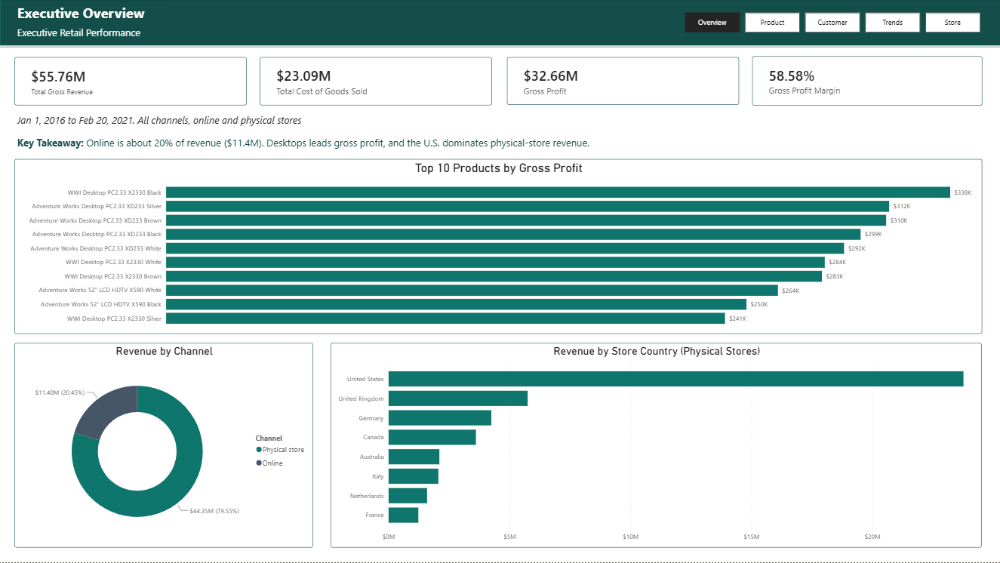
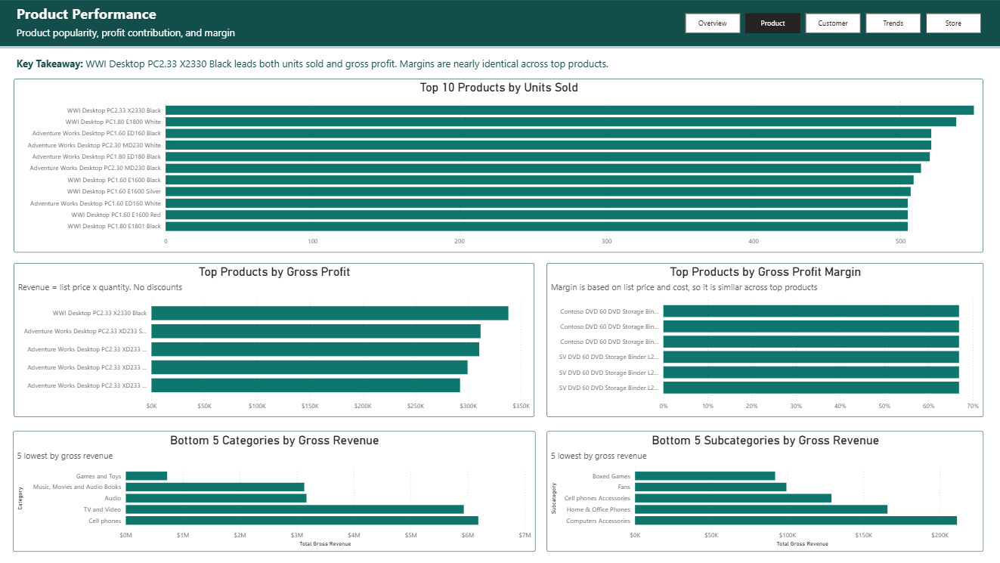
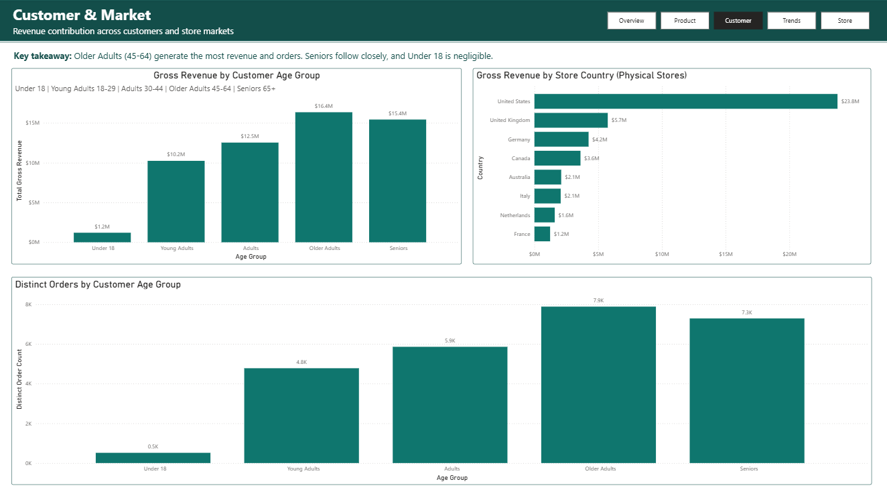
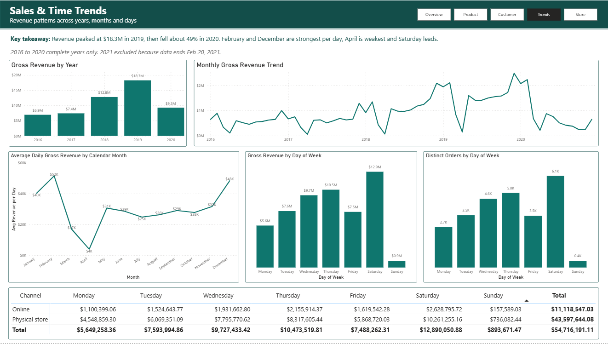
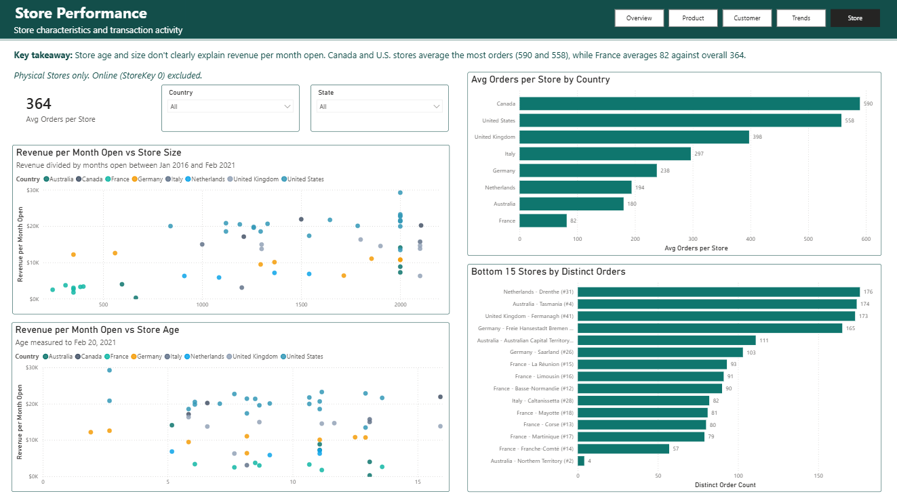
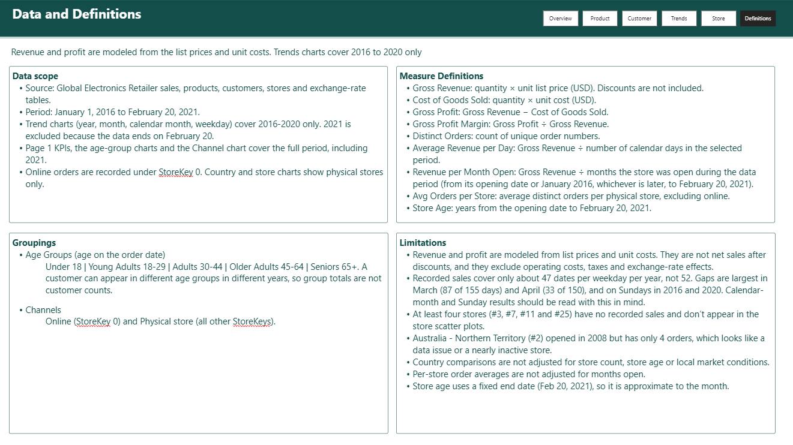

# Global Electronics Retailer: Sales Performance Dashboard

A five-page Power BI report that analyzes sales, products, customers and stores for a global electronics retailer. It answers 10 business questions and documents the data-quality problems I found while validating it.

**Tools:** Power BI Desktop, DAX
**Data:** [Maven Analytics Data Playground: Global Electronics Retailer](https://mavenanalytics.io/data-playground/global-electronics-retailer?datasetId=25S4VOgB1WMVMAUo90JzSv)
**Period:** January 1, 2016 to February 20, 2021 (trend charts cover 2016-2020, the five complete years)

---

## Business questions

| # | Question | Page |
|---|---|---|
| 1 | Which products sell the most? | Product Performance |
| 2 | Which products generate the most gross profit? | Product Performance |
| 2.1 | Which products have the best profit margin? | Product Performance |
| 3 | Which customer age group contributes the most revenue? | Customer & Market |
| 4 | Which country has the most sales? (physical stores; online shown separately) | Executive Overview, Customer & Market |
| 5.1 | What is the overall sales trend by year? | Sales & Time Trends |
| 5B.1 | How does revenue change month by month? | Sales & Time Trends |
| 5B.2 | Which calendar months generate the most revenue per day? | Sales & Time Trends |
| 6 | Which day of the week has the highest sales and orders? | Sales & Time Trends |
| 7 | Do older or newer stores perform better? | Store Performance |
| 8 | Do larger stores perform better than smaller ones? | Store Performance |
| 9 | Which categories and subcategories perform poorly? | Product Performance |
| 10 | How many orders does each store receive? | Store Performance |

---

## Key findings

1. **Online is a fifth of revenue.** Online sales are $11.4M of $55.76M (20.45%), and physical stores are $44.35M. The country charts show physical stores only, so any market comparison needs to say whether online is included.
2. **Revenue peaked in 2019, then halved.** Revenue grew from $6.9M (2016) to $18.3M (2019), then fell 49.1% to $9.3M in 2020.
3. **The U.S. dominates physical-store revenue.** It earns $23.8M, or 53.6% of the physical-store total. The UK is second at $5.7M (13.0%), and France is last at $1.2M (2.8%).
4. **Older customers drive revenue.** Customers aged 45-64 generate $16.4M and those 65+ generate $15.4M. Older Adults also place the most orders (7.9K). Only customers under 18 contribute little ($1.2M).
5. **One desktop leads on both units and profit.** WWI Desktop PC2.33 X2330 Black sold about 550 units and earned $338K in gross profit. Desktops are 8 of the top 10 products by gross profit, and the other two are 52" LCD HDTVs.
6. **Country looks like a stronger driver of store performance than age or size.** Using revenue per month open, store age and size show no clear relationship with revenue. Average orders per store vary far more by country: Canada 590, U.S. 558, UK 398, Italy 297, Germany 238, Netherlands 194, Australia 180, France 82 (overall average 364).
7. **Boxed Games is the weak spot in Games and Toys.** Games and Toys is the lowest category ($724.8K revenue), but Download Games brings in $632.9K of that. Boxed Games earns only $92.0K.
8. **Seasonality needs a data check.** Per calendar day, February ($52K) and December ($48K) are strongest and April ($4K) is weakest. But April has recorded sales on only 33 of 150 days, so the dip is at least partly a data gap (see below).

Full wording for every insight is in [`docs/business-insights.md`](docs/business-insights.md).

---

## Data quality findings

Validating the dashboard against the underlying tables turned up several issues. None of them are visible in a chart on their own, so I documented them here and on the report's Definitions page.

| Finding | Evidence |
|---|---|
| **Sales dates are missing in March and April** | Sales are recorded on only 87 of 155 March days and 33 of 150 April days (2016-2020), against 140 or more in every other month. Per selling day, April is about $18K against about $30K in March and May. |
| **Sundays are both sparse and small** | Sunday has recorded sales on only 26 dates in 2016 and 25 in 2020, against 47 in 2019. Sunday revenue is $0.9M (1.6% of the total), and it is low in both channels (online $158K, stores $736K). Even in a complete year, Sunday revenue per selling day is far below Saturday's. |
| **Four stores have no recorded sales** | Stores #3, #7, #11 and #25 have no revenue, so they don't appear in the store scatter plots. |
| **One long-open store has almost no orders** | Australia - Northern Territory (#2) opened in January 2008 but has only 4 orders ($15.2K revenue). |
| **Revenue is modeled, not net** | Revenue is quantity × list price and cost is quantity × unit cost. Discounts, operating costs, taxes and exchange rates are not included. |

---

## Report pages

| Page | What it shows |
|---|---|
| **Executive Overview** | KPI cards, top 10 products by gross profit, revenue by channel, revenue by store country |
| **Product Performance** | Units sold, gross profit, margin, and the weakest categories and subcategories |
| **Customer & Market** | Revenue and orders by age group, revenue by store country |
| **Sales & Time Trends** | Yearly, monthly, calendar-month and weekday patterns, plus a channel-by-weekday matrix |
| **Store Performance** | Revenue per month open against store size and age, orders per store by country, lowest-volume stores |
| **Definitions** | Data scope, measure definitions, groupings and limitations |

---

## Data model and method

- **Star schema:** `Products`, `Customers`, `Stores` and `Date` each connect one-to-many into `Sales`, with single-direction filtering.
- **Date table:** built with `CALENDAR` from the first to the last order date.
- **Channel:** online orders are recorded under StoreKey 0. A calculated column labels each store as Online or Physical store, and the country and store charts filter to physical stores.
- **Normalized store comparison:** store revenue is compared as *revenue per month open*, so older stores don't win simply by trading longer.
- **Seasonality:** calendar-month revenue is divided by calendar days, so shorter months (February) aren't penalized.
- **Age:** calculated at the order date, so a customer can fall into different age groups across years.
- **Trend pages** exclude 2021, since the data ends on February 20, 2021.

All measures and calculated columns are in [`docs/dax-measures.md`](docs/dax-measures.md).

---

## What I would do next

- Ask the data owner why sales dates are missing in March, April and on some Sundays.
- Add store count by country, to separate "more stores" from "stronger stores".
- Add average order value to test whether Friday's revenue per order differs from Thursday's.
- Check why four stores have no sales, and whether store #2's four orders are real.
- Add year-over-year growth as a tooltip on the yearly chart.

---

## How to open the report

1. Download `Global_Electronics_Dashboard.pbix`.
2. Open it in Power BI Desktop (free for Windows).
3. The data is imported into the file, so no connection is needed to view it.

### Source data

The original CSV files are in the [`data/`](data/) folder, unmodified from the Maven Analytics dataset (the source link is at the top of this page). No Power Query transformations were applied, so the report is built directly on these files. To refresh or rebuild the report, open **Transform data → Data source settings** in Power BI Desktop and point each table to the matching file in `data/`.

| File | Contents |
|---|---|
| `Sales.csv` | Order lines (order number, dates, store, product, customer, quantity) |
| `Products.csv` | Product details, unit cost and unit price (USD) |
| `Customers.csv` | Customer location and birthday |
| `Stores.csv` | Store country, state, size and opening date |
| `Exchange_Rates.csv` | Currency exchange rates (not used in any measure) |

---

## About

Built as a first Power BI dashboard project while learning data analytics.
